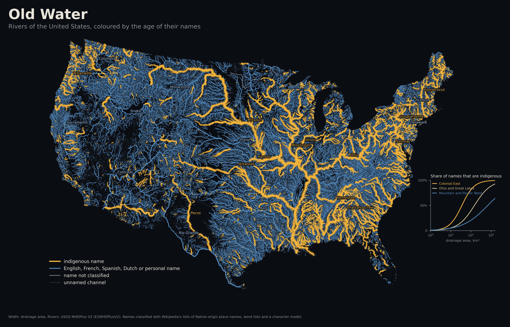
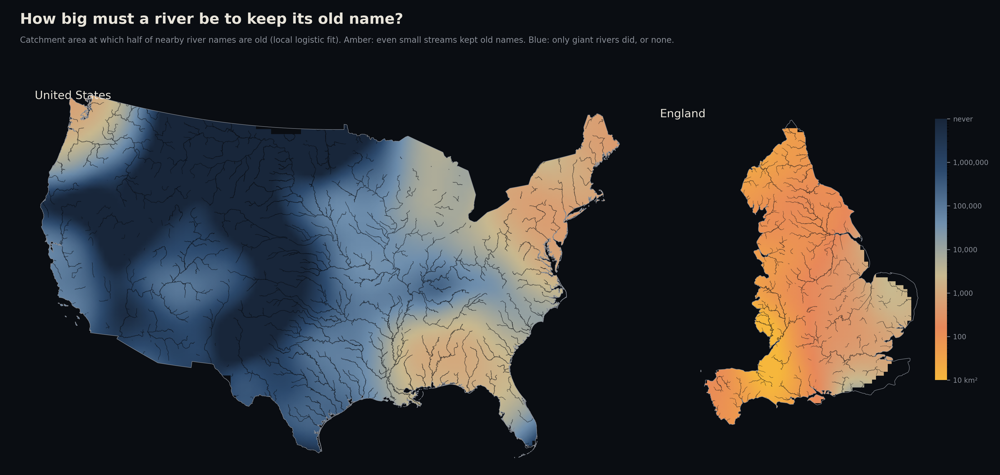
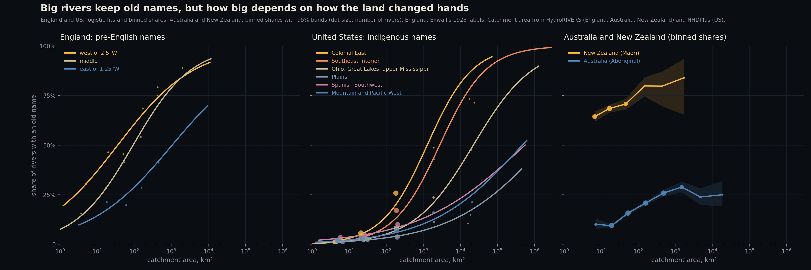
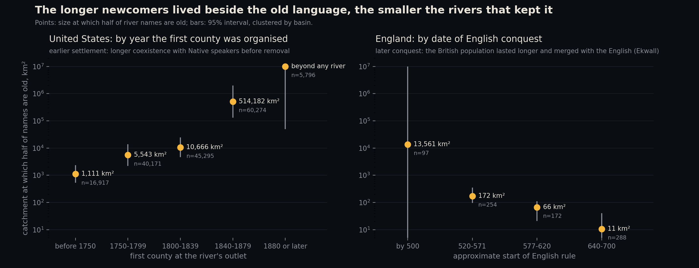
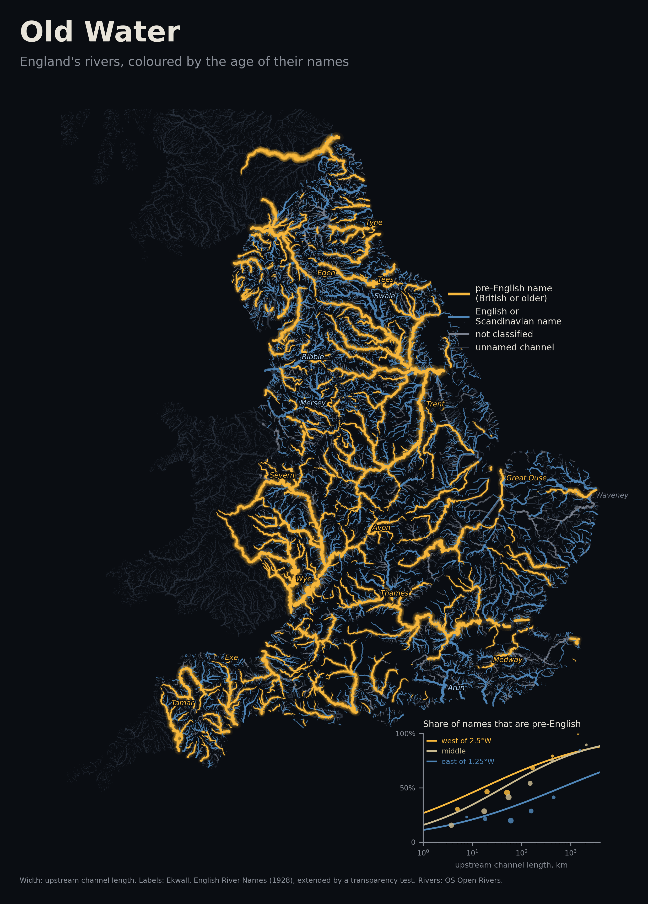
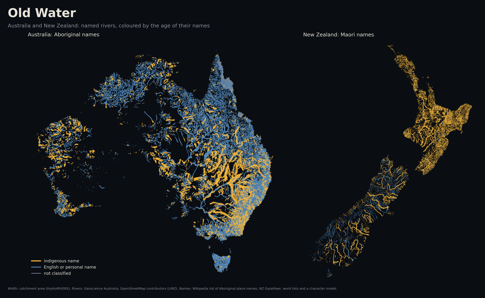

# Old Water

**Do big rivers keep the oldest names?**

When one language replaces another, the newcomers rename the small streams and inherit the names of the big rivers. Philologists have said so for a century. Eilert Ekwall wrote in 1928 that in England "names of more important rivers are predominantly pre-English". The Thames, Severn, Trent and Exe are Celtic or older; the brooks and becks are English. In America the Mississippi and the Susquehanna kept their names while ten thousand streams became Bear Creek.

This project tests the claim on every named river in four countries where one language replaced another: England, the conterminous United States, Australia and New Zealand. It measures how the share of old names rises with river size, and asks what sets the size at which a river is big enough to keep its name.



## What it finds

- **Big rivers do keep old names.** In England and the US, every tenfold increase in catchment area multiplies the odds of an old name by about 2.5 and 3.
- **How big "big" is depends on how the land changed hands.** Half of river names are pre-English at about 40 km² of catchment in western England and about 1,000 km² in the east. In the colonial eastern US, half are indigenous at about 1,300 km²; in the US West, even the Columbia, the Snake and the Sacramento carry newcomer names.
- **Contact time predicts the threshold.** Across the US, the earlier a place was organised into counties, the smaller the rivers that kept indigenous names: half are indigenous at 1,100 km² where the first county came before 1750, 11,000 km² for 1800 to 1839, and never within the size of real rivers after 1880. The effect holds within regions. In England, the later the English conquest (and the longer the British population lasted), the smaller the rivers that kept British names: 172 km² for counties taken in 520 to 571, 11 km² for 640 to 700.
- **The prediction that could fail did not.** Australia's trunk rivers were named by explorers after patrons (Murray, Darling, Lachlan, Macquarie). There the size gradient stops: among rivers over 300 km², bigger ones are no more likely to carry Aboriginal names (odds ratio 1.03, 95% CI 0.80 to 1.32), against 9.3 in England and 2.1 in the US. New Zealand, settled through decades of dealings with Maori communities, kept Maori names on about two thirds of small streams and four fifths of large rivers.
- **Ekwall's second explanation fails.** He argued that names survive where streams are packed close together, because each needs telling apart. Old names are rarer where channels are dense, even within the south of England where he made his own comparison.



## Four countries

| Country | Named rivers | Old names | Odds ratio per 10× catchment | Half of names old at | Among rivers over 300 km² |
|---|---|---|---|---|---|
| England (Ekwall's labels) | 911 | 42% | 2.53 [1.99, 3.20] | 133 km² [80, 236] | 9.3 [3.9, 28.8] |
| United States | 170,395 | 3.6% | 3.05 [2.80, 3.33] | 24,650 km² [13,294, 45,705] | 2.09 [1.83, 2.38] |
| Australia | 26,373 | 17% | 1.78 [1.44, 2.21] | not meaningful: the share stalls near 25% | 1.03 [0.80, 1.32] |
| New Zealand | 4,934 | 69% | 1.62 [1.23, 2.14] | below the smallest streams | 1.65 [0.35, 7.79] |

All intervals are 95% and account for clustering by basin (see How sure). Catchment area is from HydroRIVERS in England, Australia and New Zealand and from NHDPlus in the US.



## Why: the longer the contact, the smaller the rivers that kept old names



**United States.** Each river outlet is dated by the year the first real county was organised there (Newberry Library, Atlas of Historical County Boundaries), ignoring nominal units such as "Louisiana Purchase" and colonial counties that on paper reached the Mississippi. In a model with log catchment, every century later lowers the log-odds of an indigenous name by 0.54 [0.35, 0.72]. With region fixed effects the effect shrinks to 0.31 [0.02, 0.59] but stays. The size gradient itself weakens with later settlement (interaction −0.50 [−0.68, −0.32]):

| First county at the outlet | Streams | Odds ratio per 10× | Half of names indigenous at |
|---|---|---|---|
| before 1750 | 16,917 | 4.8 | 1,111 km² [529, 2,330] |
| 1750 to 1799 | 40,171 | 4.8 | 5,543 km² [2,211, 13,895] |
| 1800 to 1839 | 45,295 | 3.7 | 10,666 km² [4,631, 24,563] |
| 1840 to 1879 | 60,274 | 2.2 | 514,182 km² [131,269, 2,014,052] |
| 1880 or later | 5,796 | 1.8 | beyond any river |

**England.** Each of Ekwall's county groups gets an approximate date of English control from the standard chronology ([data/labels/england_conquest.csv](data/labels/england_conquest.csv): Hengest in Kent, Dyrham 577, Chester 616, Elmet 617, Penselwood 658, Carlisle 685). Later conquest raises the log-odds of a British name by 0.87 per century [0.61, 1.18] at a given size. Longitude does almost as well (0.48 per degree west), and the two share most of their information. This is the pattern Ekwall described: in the districts conquered first, the British were displaced; where conquest came late, they lived on and merged, and their names passed into English.

| English rule from | Rivers | Half of names pre-English at |
|---|---|---|
| by 500 | 97 | too few large rivers to fix |
| 520 to 571 | 254 | 172 km² [96, 351] |
| 577 to 620 | 172 | 66 km² [21, 111] |
| 640 to 700 | 288 | 11 km² [1, 41] |

**Density.** Holding size and longitude fixed, the coefficient on log channel density is negative: −1.06 [−1.61, −0.48]; −1.02 with Scandinavian names dropped; −0.89 [−1.66, −0.04] in the south alone. Ekwall's idea that crowded networks needed distinct names, and so kept old ones, does not fit the data.

**Renaming, inconclusive.** Ekwall's dictionary entries sometimes record a replaced name ("An earlier name was Bramber"). Of 429 entries matched to rivers, 37 do, and they are more common for bigger rivers (odds ratio 1.75 per tenfold, p = 0.03). But bigger rivers are also far more likely to be recorded at all before 1100 (odds ratio about 3 per tenfold), so these records measure which rivers were written about, not which were renamed.

## How sure

**Clustering.** Streams in one basin were often named by the same people, so they are not independent. Every interval above resamples whole basins (England: 217 basins) or uses errors clustered by basin (US: 203 HUC4 subregions; Australia and New Zealand: HydroRIVERS basins). In the US this widens the slope's standard error 2.7×. No conclusion changes.

**Size.** Catchment areas snapped from HydroRIVERS match 887 NRFA gauged catchments in England at r = 0.93 (log scale; median ratio 1.05, 85% within a factor of 1.5). A channel that runs beside a bigger river can snap to it and inherit its catchment: marsh sewers beside the Thames estuary, anabranches beside the Murray. In England a snapped area is kept only when it agrees with the river's own network size within a factor of 5 (2,787 rejected). In Australia and New Zealand, where there is no network, pieces claiming more than 20 times the area the river's length supports (Hack's law) are ignored.

**US labels.** Two independent checks:

- **GNIS histories.** 1,670 named streams have a history note in the federal names database. Read by strict rules, they give 902 usable labels. Against them the classifier's indigenous labels are right 93.5% of the time, and it finds 66% of the indigenous names; recall rises from 40% for streams under 10 km² to 93% above 1,000 km². GNIS histories over-represent indigenous names (their stories get written down), so these miss rates are pessimistic.
- **A stratified audit.** 400 names, 40 in each combination of five size bands and two labels, were read one by one. **These audit labels were made by the AI model that built this project (Claude), using the GNIS history where one exists and general etymological knowledge otherwise; they are not expert labels.** They agree with the GNIS rule on 95% of the 21 names where both exist. Among names labelled indigenous, 89% were judged truly indigenous (only 55% for streams under 10 km², where the character model over-calls). Among names labelled newcomer, none of 198 were judged indigenous.

Refitting the curve to the audit's accuracy, cell by cell:

| US curve | Odds ratio per 10× | Half of names indigenous at |
|---|---|---|
| As labelled | 3.05 | 24,650 km² |
| Corrected with the audit | 2.60 [2.47, 2.75] | 45,196 km² [31,126, 66,022] |
| Corrected with GNIS miss rates (pessimistic) | 1.67 | 27,337 km² |
| Model-labelled names dropped | 3.98 | 25,637 km² |
| Every name judged by the character model alone | 2.93 | 42,642 km² |
| Tribe names and state names on creeks counted as newcomer | 2.90 | 49,538 km² |

In every version the corrected regional order is the same: Colonial East first, the West last.

**Australia.** The 150 largest named rivers, where the reversal test is decided, were also checked by hand (by the same AI reader, [data/labels/au_top150_labels.csv](data/labels/au_top150_labels.csv)). The classifier agreed on 94% of those it labelled; it missed six Aboriginal names (Barwon, Barcoo, Macumba, Gunningbar, Alberga, Moonie) and wrongly called the Condamine Aboriginal. The hand labels are used for those rivers.

**England.** Ekwall's county lists are the labels. A word-list test was tried as a way to extend them, and it fails: 38% of Ekwall's pre-English names read as English words (Cam, Dart, Axe, Arrow, Glaze), and half of his English names are Old English words modern dictionaries no longer know. So the English results rest on his labels; the rest of the network gives bounds (half of names old at 513 to 531 km², depending on how unreadable names are counted).





## Interactive map

[docs/index.html](docs/index.html) is a map of all four countries: hover any river for its name, its class and the evidence behind it (Ekwall's county list, the Wikipedia list, the word reading, the model score, the GNIS history). It works on GitHub Pages from the `docs` folder, and is also published as a private Artifact at <https://claude.ai/artifact/CEW2ExcM58ijjZxy6LjGHD> (open to others only once shared from its Share menu).

## Data

> The raw inputs are not in this repository. [DATA.md](DATA.md) records exactly which files were used, with sizes and fingerprints, and how to re-fetch them.

| Source | What | Access |
|---|---|---|
| [OS Open Rivers](https://www.ordnancesurvey.co.uk/products/os-open-rivers) | 193,040 watercourse links for Great Britain, with names | Open Government Licence |
| [E2NHDPlusV2](https://www.sciencebase.gov/catalog/item/65cbbb98d34ef4b119cb37c9) (USGS, v3.0, 2024) | NHDPlus V2 flowlines with GNIS names, drainage area, HUC codes | Public domain |
| [Surface Hydrology Lines (National)](https://data.gov.au/data/dataset/surface-hydrology-lines-national) | Geoscience Australia watercourses, 1.16 million named lines | data.gov.au |
| OpenStreetMap waterways, New Zealand | 29,048 named lines, largely LINZ imports | Overpass API, ODbL |
| [HydroRIVERS v1.0](https://www.hydrosheds.org/products/hydrorivers) | River network from the HydroSHEDS elevation model, with upstream area | Free, citation required |
| Eilert Ekwall, *English River-Names* (Oxford, 1928) | County lists of river-name origins (Introduction, ch. IV), dictionary entries | [archive.org](https://archive.org/details/englishrivername0000eile) |
| [NRFA](https://nrfa.ceh.ac.uk/) station metadata | Gauged catchment areas, 1,604 UK stations | Public web service |
| [GNIS](https://www.usgs.gov/us-board-on-geographic-names) feature histories | Free-text histories of 55,000 US features | USGS, public domain |
| [Atlas of Historical County Boundaries](https://digital.newberry.org/ahcb/) | Every US county dated to the day, 1629 to 2000 | Newberry Library, CC BY |
| [NZ Gazetteer](https://gazetteer.linz.govt.nz/) | Official names with a Maori-name flag | LINZ, CC BY |
| Wikipedia lists | Place names of Native American origin (28 lists), of Aboriginal origin, Native peoples, English words of Aboriginal origin | MediaWiki API |
| hunspell dictionaries ([wooorm/dictionaries](https://github.com/wooorm/dictionaries)); US Census 2010 surnames; US given names 1880 to 2008 | Word lists for reading names | Public |

## Method

**Rivers and size.**
- England: OS links are grouped into named rivers (same name, joined in the network; pieces within 1 km merged), with side channels and named pools dropped. Size is catchment area from HydroRIVERS where it agrees with the river's own upstream channel length, otherwise converted from that length.
- United States: one river per GNIS feature; drainage area from NHDPlus.
- Australia and New Zealand: lines grouped by name and shared endpoints (pieces within 1 km merged; 'River Murray' and 'Murray River' are one key); catchment from HydroRIVERS with a two-of-three snapping rule and the Hack's-law cap.

**Which names are old.**
- England: Ekwall's county lists, transcribed by hand from the 1928 text ([data/labels/ekwall_1928_ch4.txt](data/labels/ekwall_1928_ch4.txt)) and matched by name and county.
- United States, in order: documented overrides (the Delaware, named for Lord De La Warr; the Pee Dee, named for the Pee Dee people); Wikipedia's lists of Native-origin place names, minus English names honouring Native people (Logan, Jefferson) and plain translations (Licking, Platte); tribe names; readings as English, a personal name, French, Spanish, Dutch or German (with full hunspell morphology, so Brazos and Des Moines are found); a character n-gram model for the rest (cross-validated AUC 0.96).
- Australia: Wikipedia's list of Aboriginal place names, the same readings plus Gaelic and Norman surname forms (Macquarie, Fitzroy), Aboriginal loanwords counted as English (Coolabah, Brigalow), and a character model (AUC 0.97).
- New Zealand: the NZ Gazetteer's Maori flag; otherwise Maori spelling rules, which are strict enough that a name breaking them is not Maori. Dual names restored recently ('Clutha River / Mata-Au') are judged by their historical first part.

Words that English borrowed from indigenous languages and used as ordinary words (Hickory, Raccoon, Chinquapin, Coolabah, and the Chinook Jargon of Skookum Creek) count as newcomer namings. Tribe names count as old words but are tested separately, since naming a river after a people was usually a newcomer's act.

**Statistics.** Logistic regression of old name on log catchment area; the half-old size is where the curve crosses 50%. Intervals from a basin bootstrap or cluster-robust errors. The threshold map fits a local logistic curve at every grid point, weighting nearby rivers by a Gaussian kernel (175 km in the US, 45 km in England).

## Caveats

- **Contact is measured indirectly.** County founding dates and conquest dates stand in for how long newcomers lived beside speakers of the old language. Both also track terrain, colonial power and settlement density. The within-region US test and the English gradient, where language and period are fixed, are the strongest evidence; neither is an experiment.
- **England's conquest dates are approximate** and rest on the Anglo-Saxon Chronicle and standard histories. A national gazetteer of early Anglo-Saxon cemeteries would be a better, archaeological measure, but none exists in open form; Historic England's scheduled monuments list only 94 Anglo-Saxon sites, many of them later churches.
- **Ekwall's labels are from 1928.** Some etymologies have been revised since, notably by Coates and Breeze on Brittonic names, and his county lists leave out many small streams.
- **The audit labels are an AI model's readings**, checked against GNIS where possible. They estimate accuracy; they do not replace expert review. About one in ten model-labelled US names is clearly wrong, and individual rivers on the maps can be wrong.
- **Australia's labels are the weakest of the four.** The character model and the word lists catch most names, but Aboriginal names that look like English words or surnames (Barwon, Moonie) are missed unless they are on the Wikipedia list or among the 150 rivers checked by hand.
- **Not every old name is a retained name.** A river may have been renamed later with a word from the old language, and a newcomer name may have replaced an old one and then been forgotten. Both blur the curves.

## Reproduce

```bash
pip install -r requirements.txt
python src/download.py      # about 3 GB into data/raw
python src/run_all.py       # the whole pipeline, about an hour
python -m pytest tests      # known-answer checks
```

`run_all.py` runs, in order: `england_network`, `validate_size`, `us_rivers`, `ekwall`, `england_area`, `lexicon`, `classify`, `gnis_gold`, `australasia`, `analyze`, `audit`, `mechanisms`, `charts`, `surface`, `maps`, `webmap`. Results go to `results/` (summary.txt, mechanisms.txt, audit.txt, gnis_check.txt, australasia_report.txt, size_validation.txt) and figures to `figures/`.

```
src/            pipeline
tests/          known-answer checks (name parsing, word readings, Maori spelling, the weighted logit, basin bootstrap)
data/labels/    hand-made inputs: Ekwall transcription, conquest dates, US overrides, audit labels, Australian hand check
data/derived/   intermediate tables (regenerated)
results/        text summaries and curve tables
figures/        posters and charts
docs/           interactive map
```
